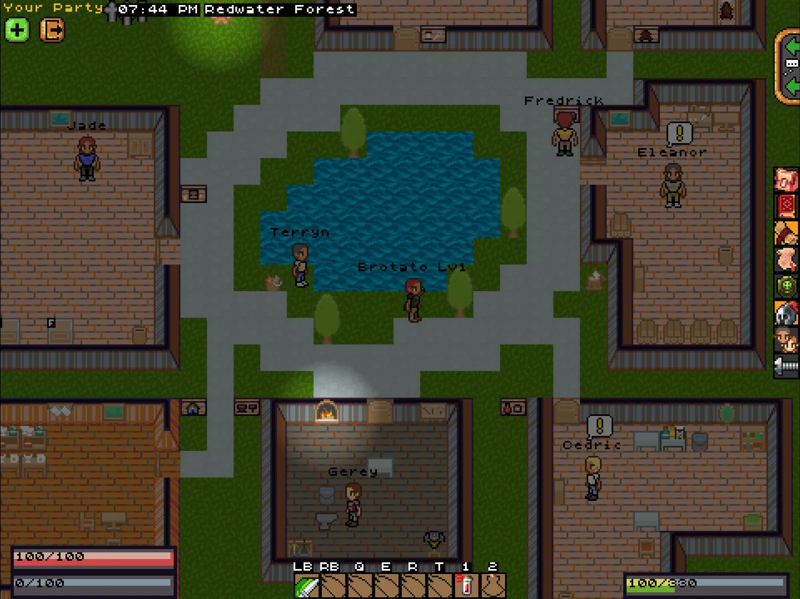
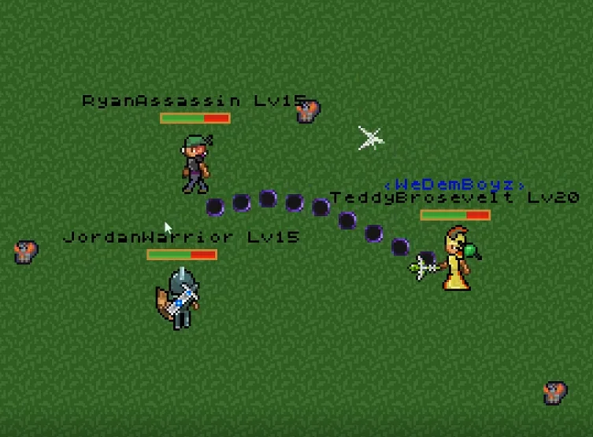

# Aetheria Online

[Visit Aetheria Online](https://aetheriaonline.online/)

## Explore the Website

Press Start game above to open Aetheria: Emberlight, the independent solo browser edition. Choose Warden, Ranger or Star Mage, then follow the journal through Tutoria Isle, Redwater Forest and Glacial Plains. Each chapter asks you to defeat enemies, collect starleaves and challenge a guardian before travelling onward.

The embedded adventure has its own local progress and rules. It does not connect to the original MMORPG servers or transfer an original account. For the original multiplayer game, visit AetheriaMMORPG’s Aetheria Online page.

If the frame cannot load, open the browser game directly. Keep this guide nearby for controls and save help.

In the browser adventure, start near camp and check the journal before setting out. The map and objective tracker help you decide where to go next. Complete the current region’s objectives before seeking its guardian; return to camp to prepare for the next chapter.

Move with WASD or the arrow keys. You can also click a destination. Use E to interact nearby and M to open the map. Click inside the game first if keyboard input is going to the page instead.

The original Aetheria Online is a fantasy MMORPG built around action combat, cooperative dungeons, PvP and crafting. The original screenshots in this guide introduce that world; they do not claim every shown feature is included in Emberlight.

Emberlight offers three choices: Warden is a durable melee fighter with Whirlwind; Ranger combines ranged attacks with Volley; Star Mage uses ranged burst damage and Starburst. Read the class description before starting a new adventure, especially if you already have a save you want to keep.

Use Space to attack, Q for your class skill, Shift to dodge and R for a potion. Watch the cooldown indicators and your health. Moving out of danger can be more useful than trying another attack immediately.

The original MMORPG also describes arena combat and guild wars. Those are original-game features, not multiplayer modes in this browser adventure. The screenshot alongside this section is an original PvP scene.

In Emberlight, camp provides rest, supplies and equipment upgrades. Check your health and potion count before leaving. Open the journal to review your remaining enemies and starleaves, then plan a short route rather than wandering without an objective.

Open the game’s pause menu to export a save backup. Progress belongs to the browser game host, not this guide. Keep the exported file before clearing browser data, changing devices or choosing a new adventure. A backup is useful only if you can find it again.

The original MMORPG emphasizes crafted equipment, character customization, quests, familiars and guilds. Consult the creator’s page for those original systems. This browser guide only describes controls and progression found in the hosted solo edition.

## Plan Your Visit

Click inside the game first. Use WASD or arrow keys to move, Space to attack and Q for your class skill. Check your range and the cooldown indicators.

A solo journey through three regions with class skills, guardians, equipment upgrades and local save backups. Start in the frame above without an original MMORPG account.

The creator’s listing presents the downloadable multiplayer RPG. Its server-based accounts, group activities and original progression are separate from the embedded adventure.

Use this independent guide to find controls, prepare a session, watch selected videos and check which edition a feature belongs to.

Two selected Aetheria videos. Footage may cover other versions; it is not a feature list for Emberlight. Previews load from YouTube, and players load when selected. The second video starts at three seconds.

The frame opens Aetheria: Emberlight, an independent solo browser adventure. It is separate from the downloadable Aetheria Online MMORPG linked in this guide.

The embedded edition uses its own local progress. It does not sign you into the original server, import your MMORPG character or provide its multiplayer activities.

Move with WASD, arrow keys or click-to-move. Space attacks, Q activates your skill, Shift dodges, E interacts, R uses a potion and M opens the map. Click inside the game before using keyboard controls.

Warden offers a sturdy melee starting point. Ranger emphasizes ranged attacks and movement. Star Mage has burst damage and lower starting health. Choose the play style you prefer; export an existing save before starting over.

Check the journal for the current chapter. Defeat the required enemies, gather its starleaves and defeat the guardian. Then return to camp to travel onward.

Use Export save in the game’s pause menu and keep the JSON file. The game also uses local browser storage. This website cannot recover lost saves or synchronize them across devices.

The embedded interface includes touch controls. The surrounding page adapts to smaller screens, but device performance and comfortable play are not guaranteed. Try fullscreen or the direct game link if the frame is too cramped.

The images below belong to the original Aetheria Online presentation, not a verified current Emberlight session. Keep that distinction in mind when comparing the guide with the game you actually open. Use the website as a companion for controls and preparation, not as a promise of original multiplayer features.

## Visit Online

[Open Aetheria Online](https://aetheriaonline.online/) to explore the website and choose your next activity.
