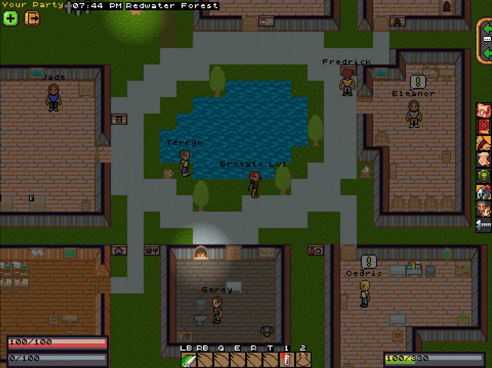
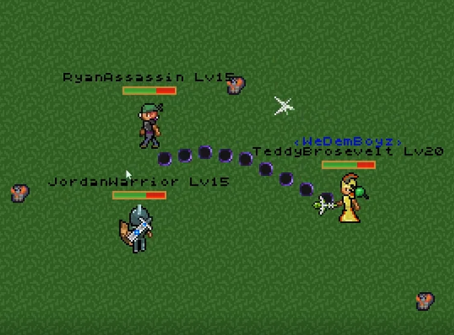
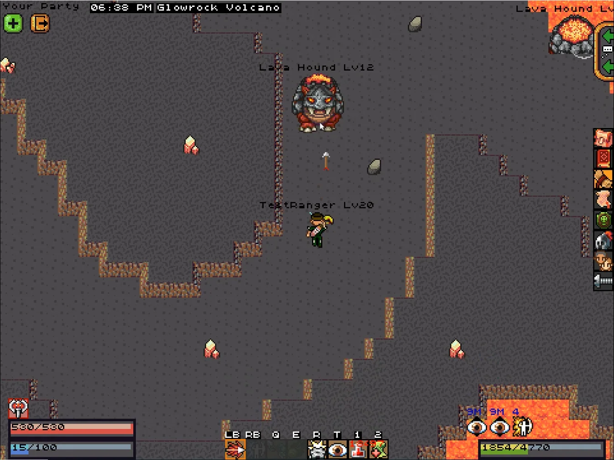

# Aetheria Online — Play the Browser Adventure

**Choose your class. Follow the embers. Find your next adventure.**

[Visit Aetheria Online](https://aetheriaonline.online/) to play **Aetheria: Emberlight**, an independent solo browser adventure. Explore three regions, battle guardians and keep controls and save help close at hand.

## Start your journey

*Original-game reference image from the creator’s itch.io gallery; not a screenshot of the embedded solo session.*

Choose Warden, Ranger or Star Mage. Follow your journal from Tutoria Isle through Redwater Forest to Glacial Plains, completing objectives before challenging each region’s guardian.

- **Play in your browser:** start from the game frame or its direct link.
- **Learn the controls:** find movement, attack, skill and dodge guidance.
- **Prepare a session:** use the personal checklist and contextual help.
- **Keep your progress:** learn how to export a local save backup.

[Start playing](https://aetheriaonline.online/#play) · [Adventure guide](https://aetheriaonline.online/#explore)

## Pick your approach to combat

*Original multiplayer reference image. Emberlight is a separate single-player adventure.*

Compare the browser edition’s class skills, watch your health and use camp to prepare for another expedition.

[Classes and controls](https://aetheriaonline.online/#craft) · [Session checklist](https://aetheriaonline.online/#prepare)

## Discover the world behind the adventure

*Original-game reference image; Glowrock Volcano is not an Emberlight chapter.*

Original Aetheria Online information is linked separately from the browser guide. Original accounts and multiplayer progression do not carry into this solo edition.

[Progress and save help](https://aetheriaonline.online/#build) · [Selected videos](https://aetheriaonline.online/#watch) · [Common questions](https://aetheriaonline.online/#faq)

## About this website

This is an independent guide, not the original developer or MMORPG server operator. Original game names and artwork belong to their creators. External games and videos require an internet connection.

[About](https://aetheriaonline.online/about/) · [Contact](https://aetheriaonline.online/contact/) · [Privacy](https://aetheriaonline.online/privacy/) · [Terms](https://aetheriaonline.online/terms/)

**[Begin your Aetheria adventure →](https://aetheriaonline.online/)**
