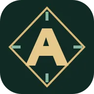
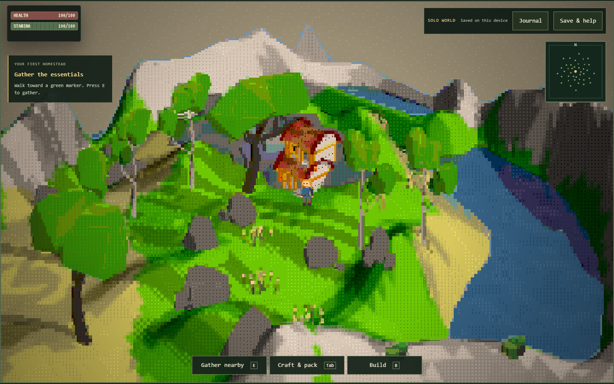
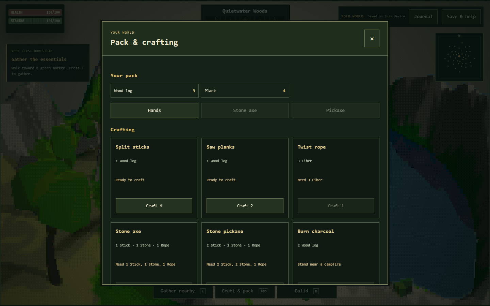
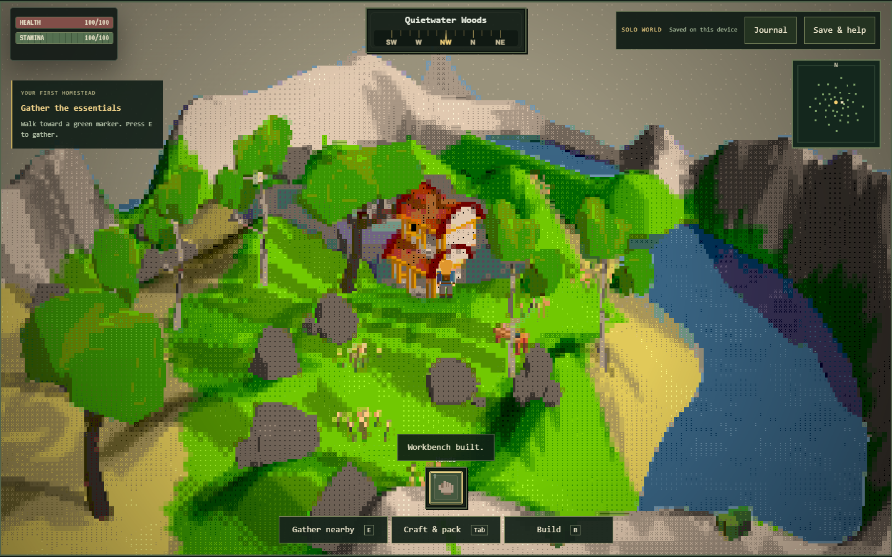

# Aetheria Online — Play Asciilands Online

**A world made of characters. An island to explore. A camp to call your own.**

[Play Asciilands online at aetheriaonline.online](https://aetheriaonline.online/) and explore the independent **Quietwater solo edition** in your browser. Start a session from the game frame, gather supplies, and discover what you can build at your own pace.

## Explore your next adventure

Explore an ASCII landscape where characters form the terrain, water and objects around you. Aetheria pairs the game with illustrated guidance so you can spend less time searching for help and more time exploring.

- **Play from your browser:** use the prominent Start game button to enter the embedded solo game.
- **Find your bearings:** follow the field guide for movement, gathering and your first supplies.
- **Plan a session:** work through a preparation checklist and choose the guidance you need.
- **Keep help nearby:** browse crafting and building explanations, selected videos and common questions below the game.

[Start playing](https://aetheriaonline.online/#play) · [Explore the field guide](https://aetheriaonline.online/#explore)

## Turn gathered supplies into something useful

Gather materials, consult the crafting guidance and plan your next step. The illustrated guide keeps exploration, crafting and building in separate sections, making it easy to return to the information you need.

[Read the crafting guide](https://aetheriaonline.online/#craft) · [Prepare your session](https://aetheriaonline.online/#prepare)

## Make a place to return to

Explore the building guidance as you develop your camp. Whether you are finding your first resources or deciding what to make next, the page keeps the game and its supporting guide together.

[Read the building guide](https://aetheriaonline.online/#build) · [Find answers](https://aetheriaonline.online/#faq) · [Browse selected videos](https://aetheriaonline.online/#watch)

## About this edition

The embedded game is **Quietwater, an independent single-player edition**, separate from the original multiplayer Asciilands. Game access requires an internet connection; a direct game link is available if embedding is unavailable. Selected videos may show a different game or edition.

Aetheria Online is an independent guide and is not affiliated with the original developer. Game names and original assets belong to their respective creators.

[About Aetheria](https://aetheriaonline.online/about/) · [Contact](https://aetheriaonline.online/contact/) · [Privacy](https://aetheriaonline.online/privacy/) · [Terms](https://aetheriaonline.online/terms/)

**[Visit Aetheria Online and start your solo adventure →](https://aetheriaonline.online/)**
